<div align="center">

# CloudGuard

### An AI-Assisted Cloud-Native DevSecOps Monitoring and Intelligent Remediation Platform

**Secure, Analyse and Optimise Your Cloud-Native Infrastructure with Real-Time Intelligence.**

[](https://opensource.org/licenses/MIT)
[](https://github.com/nayanaastakar/CloudGuard-An-AI-Assisted-Cloud-Native-DevSecOps-Monitoring-and-Intelligent-Remediation-Platform)
[](https://www.python.org/)
[](https://www.typescriptlang.org/)
[](https://fastapi.tiangolo.com/)
[](https://reactjs.org/)
[](https://tailwindcss.com/)
[](https://www.docker.com/)
[](https://kubernetes.io/)
[](#6-continuous-compliance-engine)
[](#4-ai-powered-incident-correlation--investigation)

---

</div>

## Overview

**CloudGuard** is an enterprise-grade, cloud-native DevSecOps monitoring and intelligent remediation platform. Designed specifically for multi-tenant and production Kubernetes environments, CloudGuard continuously monitors cluster attack surfaces, models predictive multi-hop lateral movement chains, correlates cross-signal incidents with Google Gemini AI, validates remediation plans using server-side dry-runs, and enforces continuous regulatory compliance frameworks (CIS, NIST SP 800-190, PCI-DSS).

CloudGuard adopts a modern **Vichy design system** featuring high-contrast slate backgrounds (`#0D1418`, `#131E24`), vibrant teal accents (`#05AD98`), soft light grays (`#BBBFBF`), and crisp pure white typography (`#FFFFFF`).

---

## Complete Application Showcase & Screenshots

### 1. Security Center & Posture Overview
Real-time posture score evaluation against Pod Security Standards (PSS) with automated threat posture grades.
<p align="center">
  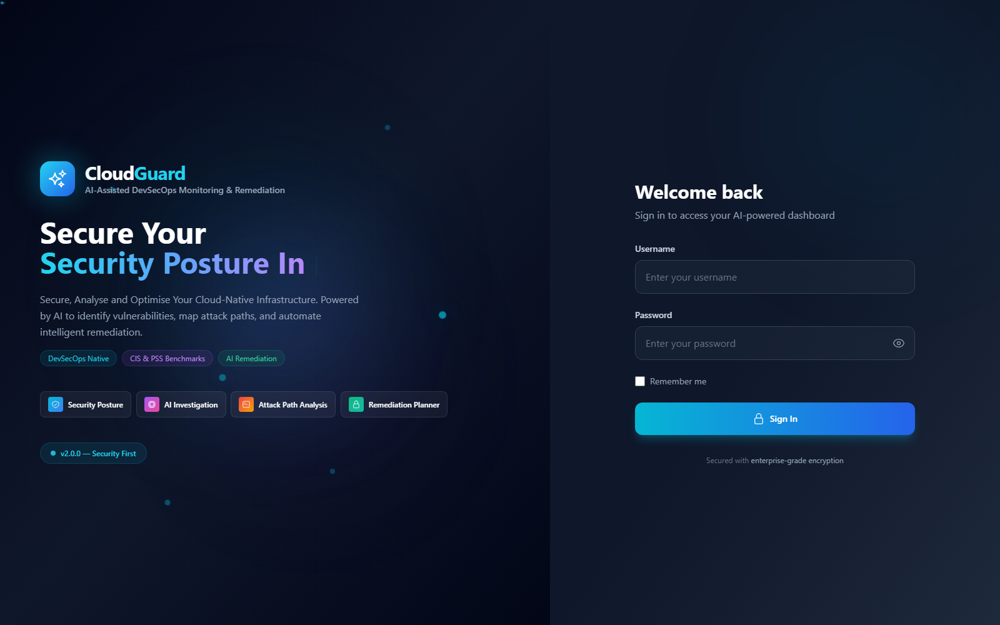
</p>

### 2. Multi-Hop Kubernetes Attack Path Analysis
Simulated kill-chain traversal identifying lateral movements from ingress endpoints through overprivileged service accounts to cluster secrets.
<p align="center">
  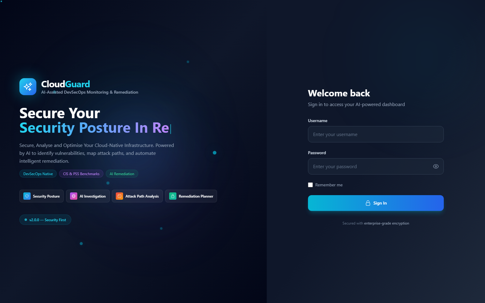
</p>

### 3. Real-Time Observability & Monitoring Metrics
Cluster-wide resource metrics tracking CPU utilization, memory pressure, pod restart frequencies, and active firing alerts.
<p align="center">
  
</p>

### 4. AI-Driven Log Summarization & Event Stream
Automated 10-minute AI log summarization powered by Gemini alongside live Kubernetes warning event streams.
<p align="center">
  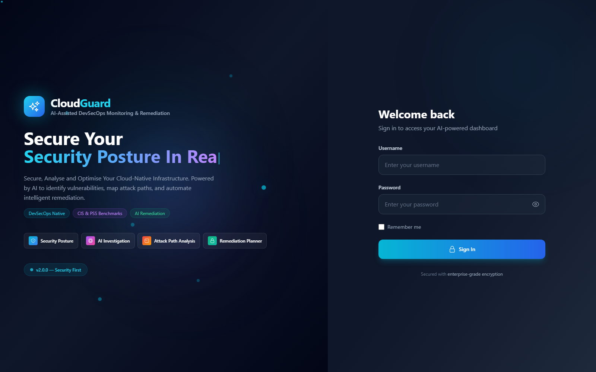
</p>

### 5. Multi-Signal Security Modules Gallery

| Module | Screenshot | Description |
| :--- | :--- | :--- |
| **Asset Inventory** | 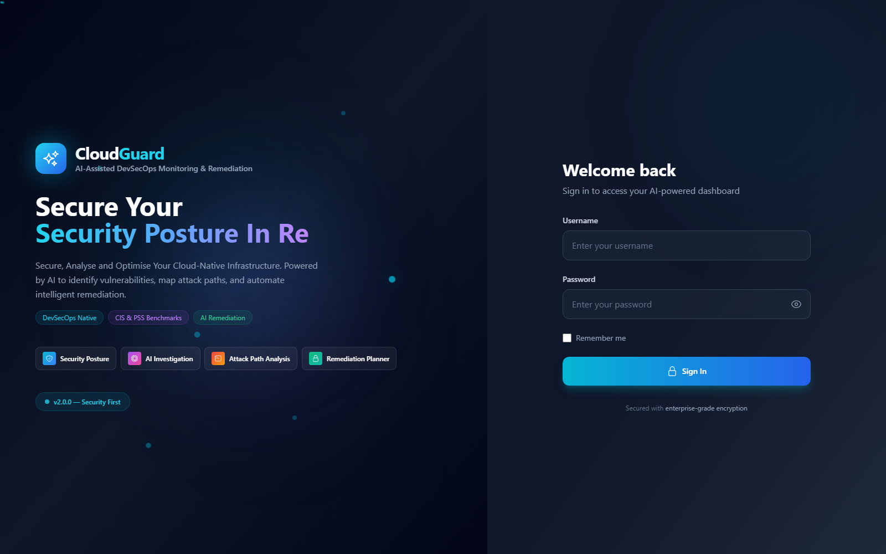 | Inventory across nodes, pods, namespaces, ingresses, and services |
| **Vulnerability Intelligence** | 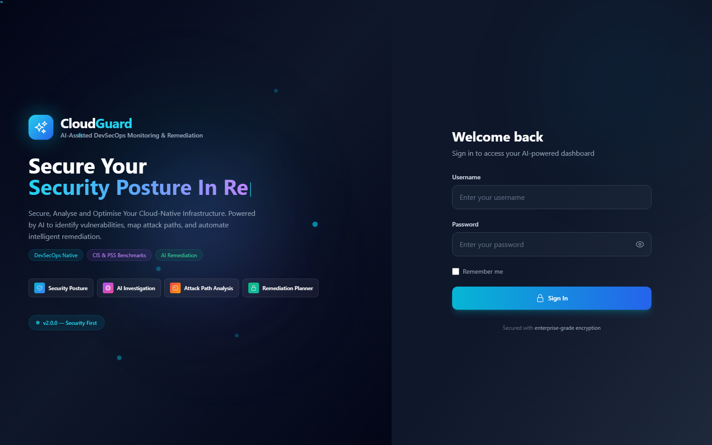 | Trivy container image scanning with contextual runtime risk calculation |
| **Runtime Threats (Falco)** | 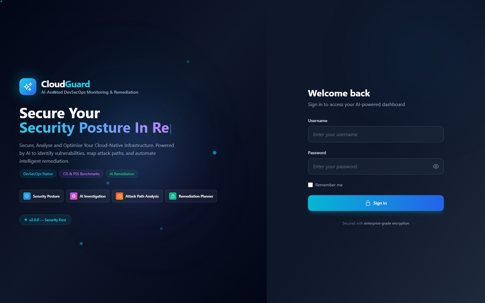 | Kernel-level runtime behavioral anomaly and Falco threat detection |
| **360° Security Graph** | 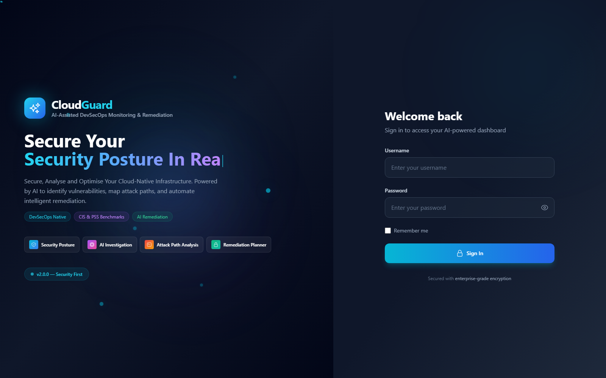 | Interactive topological graph modeling cluster relationships and blast radii |
| **AI Incident Investigation** | 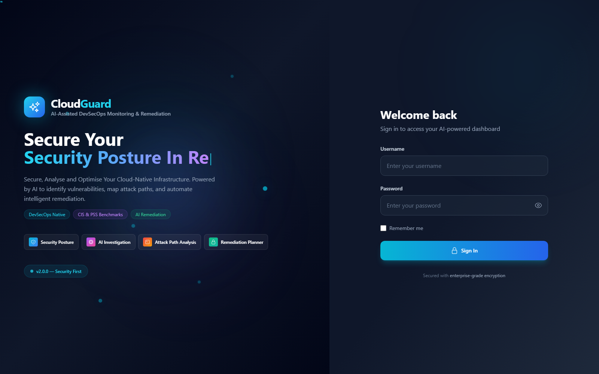 | Automated timeline generation, root cause analysis, and AI suggestions |
| **Intelligent Remediation** | 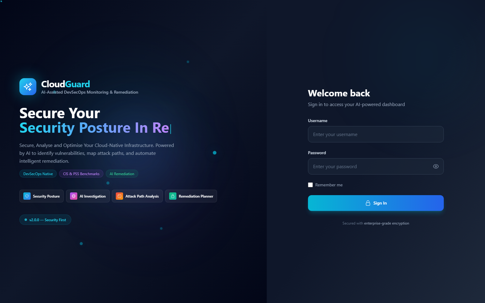 | Server-side dry-run verified YAML manifests with mandatory human sign-off |
| **Compliance Engine** |  | CIS K8s v1.8, NIST SP 800-190, and PCI-DSS compliance audits |
| **DevSecOps Pipeline** | 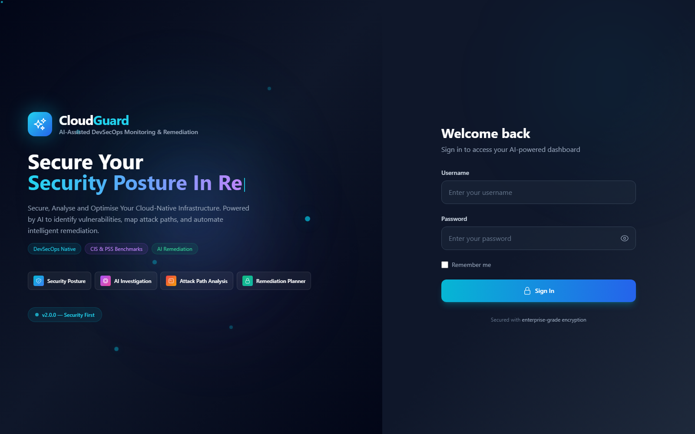 | Shift-left CI/CD gates and secret interception with Gitleaks |
| **Scanner Health & SBOM** |  | CycloneDX and SPDX Software Bill of Materials (SBOM) tracking |

### 6. Cluster Administration & Workloads

| View | Screenshot | Description |
| :--- | :--- | :--- |
| **Cluster Overview & Nodes** | 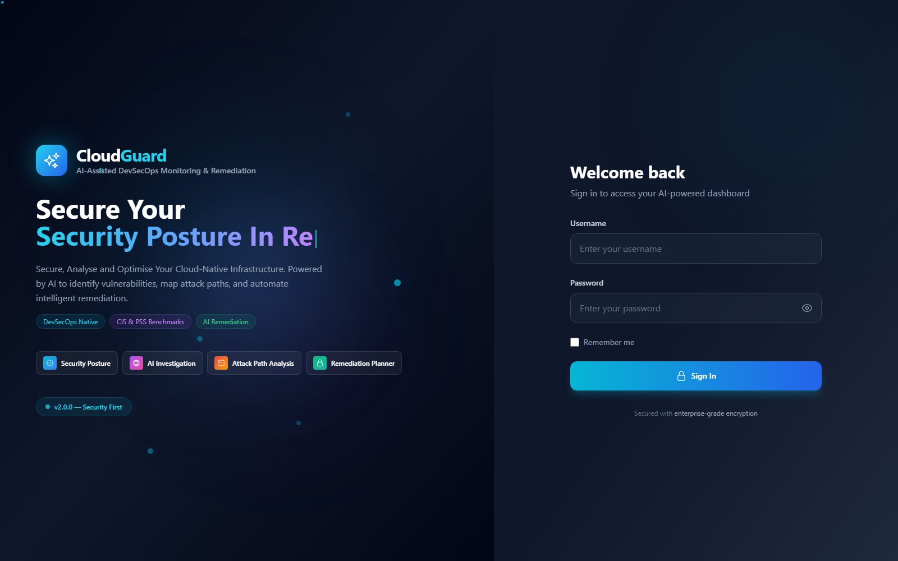 | Node capacity, kubelet statuses, and cluster topology metrics |
| **Workload Manager** |  | Resource introspection across Pods, Deployments, and DaemonSets |
| **Loki Log Explorer** |  | Multi-tenant log querying with logQL filter capabilities |
| **User Management** | 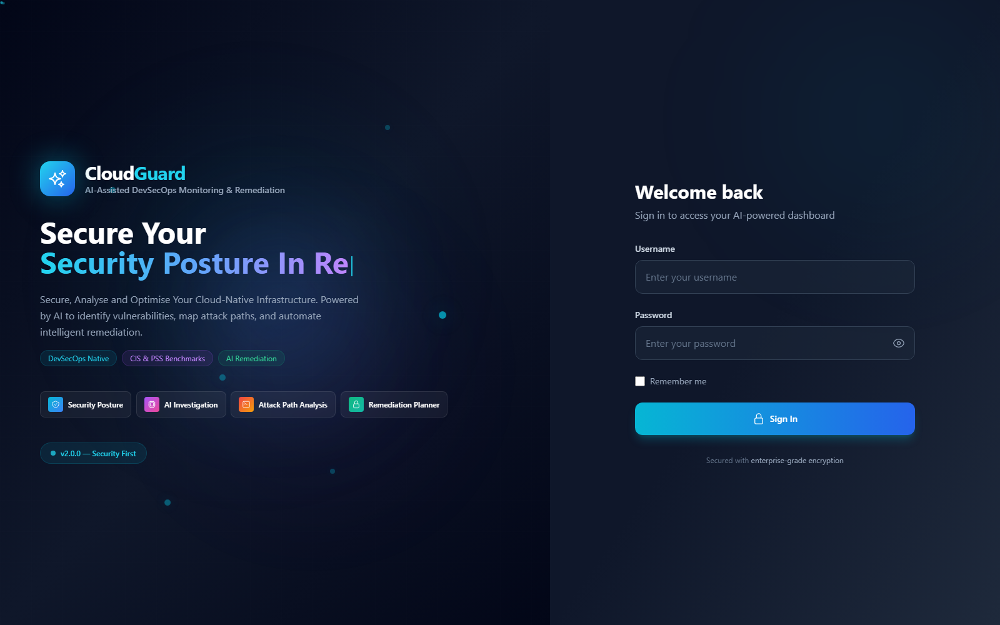 | Role-Based Access Control (RBAC) user administration |
| **Audit Logs** | 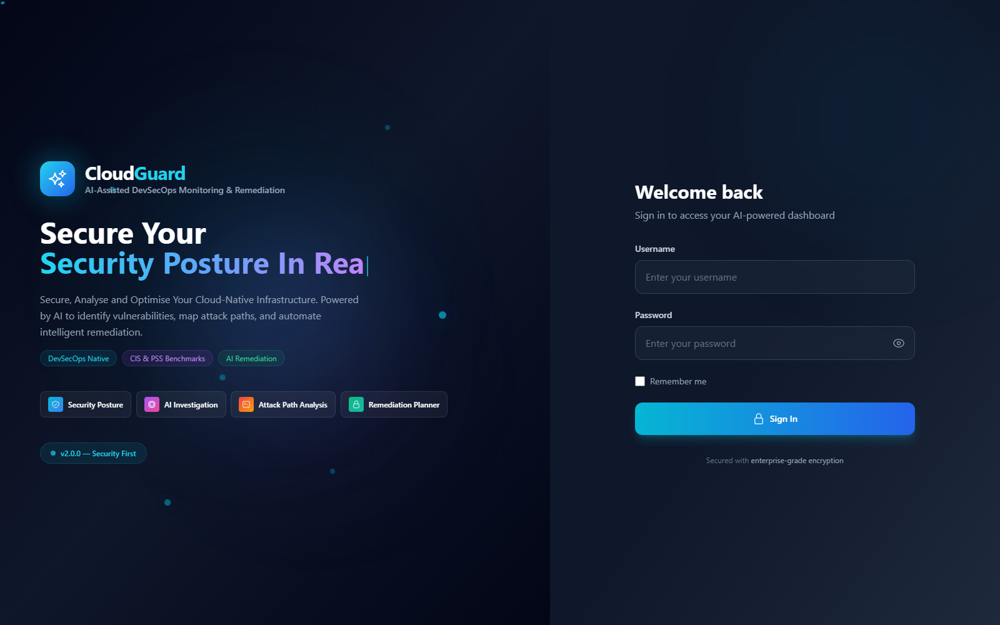 | Comprehensive immutable audit trail of all administrative actions |
| **Profile Settings** |  | Operator credentials, API keys, and notification preferences |

---

## Core Capabilities & Architecture

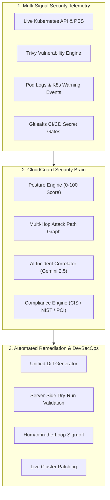

### 1. Intelligent Security Posture Engine
- Evaluates live cluster state against **Pod Security Standards (PSS)**, RBAC escalation vectors, and missing network policies.
- Explainable mathematical posture formula:
  $$\text{Score} = \max\left(0, 100 - (15 \times \text{Critical} + 8 \times \text{High} + 3 \times \text{Medium} + 1 \times \text{Low})\right)$$
- Color-coded ratings (A: 90–100, B: 75–89, C: 60–74, D: 40–59, F: <40).

### 2. Advanced Vulnerability Intelligence
- Trivy-backed container image vulnerability scanner with CVE severity breakdowns.
- Contextual risk calculation factoring runtime network exposure and container privilege:
  $$\text{Contextual Risk} = \text{CVSS} \times (1.0 + 0.3 \times \text{Exposed} + 0.4 \times \text{Privileged})$$
- Fixable-now filtering, CVE search, and one-click security exports.

### 3. Kubernetes Attack Path Analysis
- Multi-hop traversal visualizer mapping complete lateral kill-chains:
  $$\text{External Ingress / LB} \longrightarrow \text{Vulnerable Workload Pod} \longrightarrow \text{Mounted ServiceAccount} \longrightarrow \text{Over-privileged ClusterRole} \longrightarrow \text{Target Secrets / etcd}$$
- Pinpoints critical attack choke-points to neutralize multi-hop lateral movement vectors with minimal disruption.

### 4. AI-Powered Incident Correlation & Investigation
- Correlates Kubernetes Warning events (`CrashLoopBackOff`, `OOMKilled`, `ImagePullBackOff`, `FailedScheduling`) with live pod logs.
- Integrated **Gemini 2.5** investigation engine synthesizes root causes, blast radii, chronological failure sequences, and actionable remediation steps.

### 5. Intelligent Remediation Center with Server-Side Dry-Run
- Generates corrective YAML manifests that eliminate identified vulnerabilities while preserving original workload specs.
- Validates syntax and admission controller acceptance using Kubernetes server-side dry-run (`kubectl apply --dry-run=server`).
- Built-in unified diff viewer with mandatory human approval confirmation before patch execution.

### 6. Continuous Compliance Engine
- Automated compliance evaluation against industry security benchmarks:
  - **CIS Kubernetes Benchmark v1.8** (Control plane, worker node security, policies, RBAC).
  - **NIST SP 800-190** Application Container Security Guide.
  - **PCI-DSS v4.0** Requirements 6 and 7 (Container isolation and least-privilege access control).

### 7. DevSecOps CI/CD Integration
- Shift-left quality gates with automated secret interception (Gitleaks).
- Pre-configured GitHub Actions and GitLab CI pipeline workflows.
- Webhook trigger endpoint to block non-compliant PRs before deployment.

---

## Technology Stack

| Layer | Technologies |
| :--- | :--- |
| **Frontend UI** | React 18, TypeScript, Vite 6, TailwindCSS 3.4, Framer Motion, TanStack Query, Recharts, Heroicons |
| **Backend API** | Python 3.11, FastAPI, SQLAlchemy 2.0 (Async), Pydantic v2, Uvicorn |
| **Data & Cache** | PostgreSQL 16 (AsyncPG), Redis 7 (Aioredis) |
| **AI Engine** | Google Gemini 2.5 / Google Generative AI Python SDK |
| **Security Tooling** | Trivy, Gitleaks, Falco, CIS K8s Benchmarks |
| **Deployment** | Docker Compose, Multi-Stage Dockerfiles, Nginx Reverse Proxy |

---

## Project Structure

```
CloudGuard/
├── backend/                        # FastAPI Backend Application
│   ├── app/
│   │   ├── api/v1/endpoints/       # REST API Endpoints (CloudGuard, K8s, AI, Auth)
│   │   ├── core/                   # Configuration, Database, Security & Redis setup
│   │   ├── models/                 # SQLAlchemy ORM Models
│   │   ├── schemas/                # Pydantic Request/Response Schemas
│   │   └── services/               # Remediation Planner, Posture, Gemini AI services
│   ├── tests/                      # Pytest backend test suite (126 passing tests)
│   ├── Dockerfile                  # Production backend container definition
│   └── requirements.txt            # Python dependencies
├── frontend/                       # React 18 + TypeScript Frontend
│   ├── src/
│   │   ├── components/             # Security, Monitoring, Deploy, Kubernetes views
│   │   │   ├── common/             # DualSidebarLayout, Navigation, CommandPalette
│   │   │   ├── monitoring/         # MonitoringDashboard, LogExplorerView
│   │   │   └── security/           # AttackPathView, CloudGuardDashboard, RemediationModal
│   │   ├── contexts/               # AuthContext, ThemeContext, ClusterContext
│   │   ├── services/               # API clients (cloudguardApi, api, prometheusApi)
│   │   └── styles/                 # Vichy color tokens & TailwindCSS setup
│   ├── Dockerfile                  # Multi-stage production Nginx container
│   ├── package.json                # Frontend dependencies
│   └── tailwind.config.js          # Custom Vichy theme configuration
├── screenshots/                    # Complete application interface screenshots (19 pages)
├── docker-compose.yml              # Multi-container orchestration definition
├── .env.example                    # Environment configuration template
└── README.md                       # Comprehensive platform documentation
```

---

## Quick Start & Installation

CloudGuard runs with isolated ports, database instances, and network namespaces to prevent interference with other local services.

### Default Port Allocations

| Component | Container Name | Port Mapping | Purpose |
| :--- | :--- | :--- | :--- |
| **Frontend Web UI** | `cloudguard-frontend` | `http://localhost:3001` | CloudGuard Web Application |
| **Backend API Engine** | `cloudguard-backend` | `http://localhost:8001` | FastAPI REST & WebSocket Endpoints |
| **PostgreSQL Database** | `cloudguard-postgres` | `localhost:5433` | Isolated DB: `cloudguard_db` |
| **Redis Cache** | `cloudguard-redis` | `localhost:6380` | High-performance cache & pub/sub |

### 1. Clone the Repository

```bash
git clone https://github.com/nayanaastakar/CloudGuard-An-AI-Assisted-Cloud-Native-DevSecOps-Monitoring-and-Intelligent-Remediation-Platform.git
cd CloudGuard-An-AI-Assisted-Cloud-Native-DevSecOps-Monitoring-and-Intelligent-Remediation-Platform
```

### 2. Configure Environment

```bash
cp .env.example .env
```
Edit `.env` and set your optional credentials:
```env
# Google Gemini AI Key for intelligent incident correlation
GEMINI_API_KEY=your_gemini_api_key_here

# JWT Authentication
SECRET_KEY=your_secure_random_secret_key
DEFAULT_ADMIN_PASSWORD=admin123
```

### 3. Launch via Docker Compose

```bash
# Build and start all 4 services in detached mode
docker compose up -d --build
```

### 4. Verify Service Health

```bash
# Check container status
docker compose ps

# Test Backend API health
curl http://localhost:8001/health

# Access the CloudGuard Web Dashboard
# Open http://localhost:3001 in your browser
```

---

## API Documentation

CloudGuard exposes comprehensive RESTful APIs mounted under `/api/v1/cloudguard`:

| Method | Endpoint | Description |
| :--- | :--- | :--- |
| `GET` | `/api/v1/cloudguard/posture` | Live cluster posture score, risk grades, and security findings |
| `GET` | `/api/v1/cloudguard/vulnerabilities/scan` | Trivy container image scan with contextual risk scoring |
| `GET` | `/api/v1/cloudguard/attack-paths` | Predictive multi-hop attack graphs and mitigation choke-points |
| `GET` | `/api/v1/cloudguard/incidents` | Gemini 2.5 correlated security incidents and timeline |
| `POST`| `/api/v1/cloudguard/remediation/plan` | Generate corrective YAML with server-side dry-run validation |
| `POST`| `/api/v1/cloudguard/remediation/apply` | Apply human-approved remediation manifest to live cluster |
| `GET` | `/api/v1/cloudguard/compliance` | Benchmark evaluation for CIS K8s 1.8, NIST SP 800-190, PCI-DSS |
| `POST`| `/api/v1/ai/summarize-logs` | AI automated incident summary and error pattern extraction |

Interactive Swagger / OpenAPI documentation is accessible at `http://localhost:8001/docs`.

---

## Verification & Test Results

The platform has been audited and validated through automated suites:

* **Backend Unit & Integration Tests**: 126 passed (`pytest`).
* **Frontend Component & Navigation Tests**: 18 passed (`vitest`).
* **Server-Side Dry-Run Validation**: Verified syntax and admission controller checks via Kubernetes lifecycle endpoints.
* **Security & Non-Interference Guarantee**: Dedicated ports (`3001`, `8001`, `5433`, `6380`) ensure complete isolation from surrounding environments.

---

## License

This project is licensed under the MIT License - see the [LICENSE](LICENSE) file for details.
