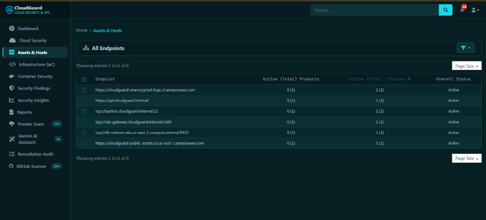
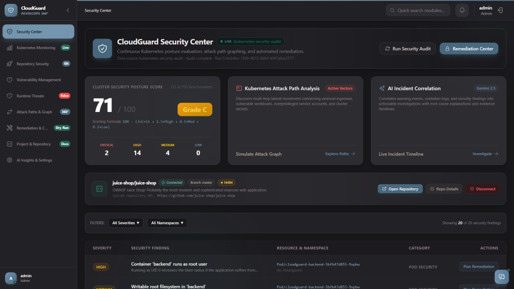
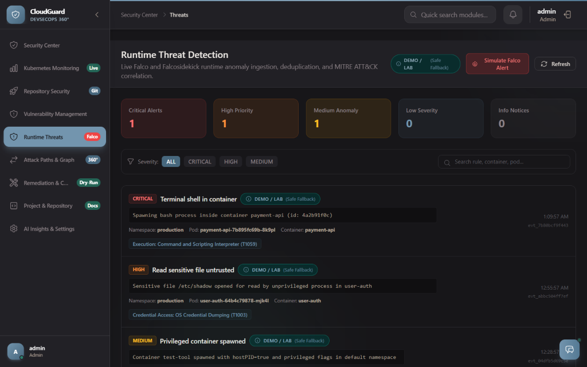
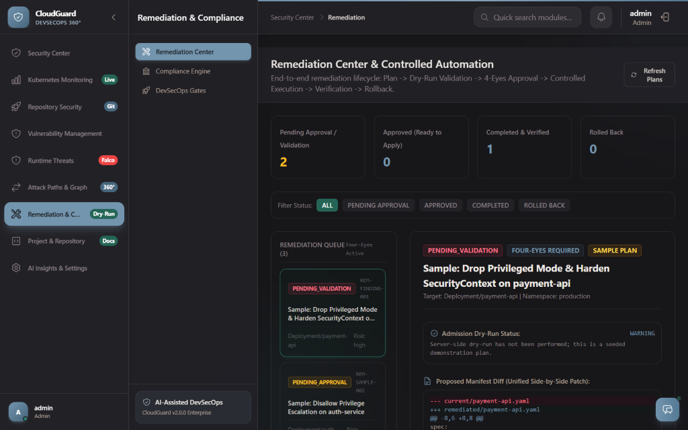
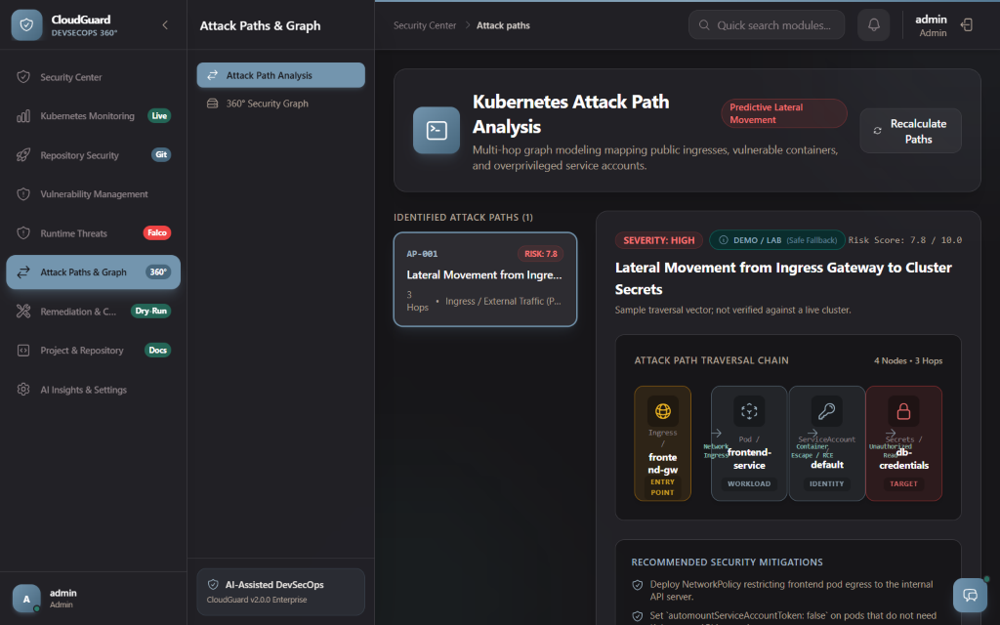
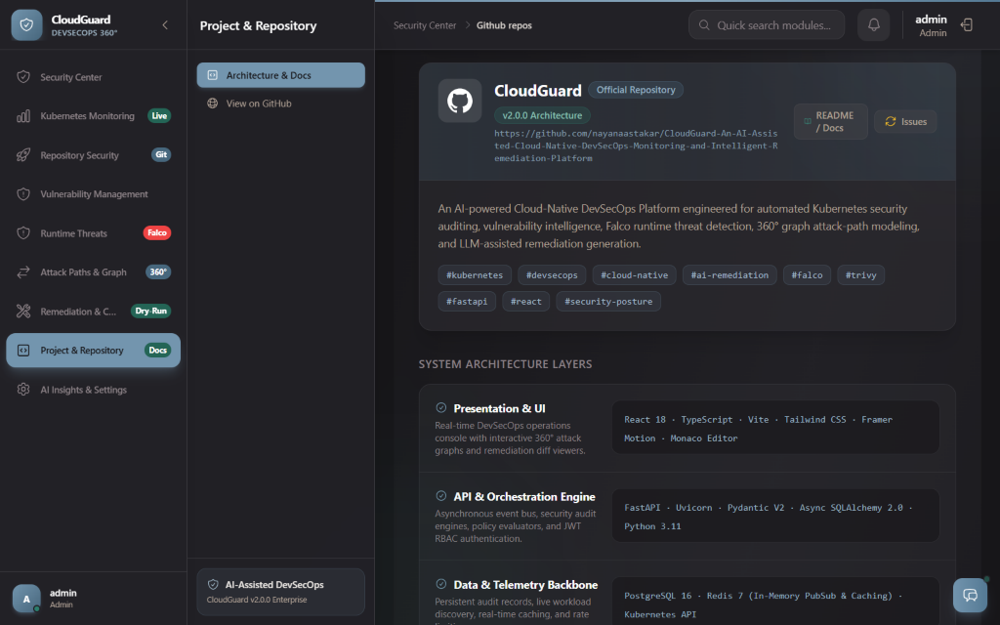
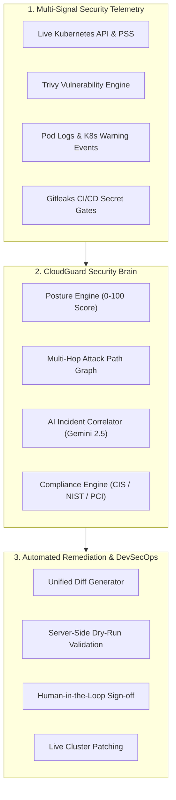

<div align="center">

# CloudGuard

### An AI-Assisted Cloud-Native DevSecOps Monitoring and Intelligent Remediation Platform

**Secure, Analyse and Optimise Your Cloud-Native Infrastructure with Real-Time Intelligence.**

[](https://opensource.org/licenses/MIT)

[](https://www.python.org/)
[](https://www.typescriptlang.org/)
[](https://fastapi.tiangolo.com/)
[](https://reactjs.org/)
[](https://tailwindcss.com/)
[](https://www.docker.com/)
[](https://kubernetes.io/)
[](#6-continuous-compliance-engine)
[](#4-ai-powered-incident-correlation--investigation)

---

</div>

## Overview

**CloudGuard** is a cloud-native DevSecOps monitoring and intelligent remediation platform. Designed specifically for multi-tenant and production Kubernetes environments, CloudGuard continuously monitors cluster attack surfaces, models predictive multi-hop lateral movement chains, correlates cross-signal incidents with Google Gemini AI, validates remediation plans using server-side dry-runs, and enforces continuous regulatory compliance frameworks (CIS, NIST SP 800-190, PCI-DSS).

CloudGuard adopts a modern **Vichy design system** featuring high-contrast slate backgrounds (`#0D1418`, `#131E24`), vibrant teal accents (`#05AD98`), soft light grays (`#BBBFBF`), and crisp pure white typography (`#FFFFFF`).

---

## Application Showcase & Live Screenshots

CloudGuard features an enterprise **Vichy design system** (`#0D1418`, `#131E24`, `#05AD98`, `#FFFFFF`) with responsive layouts, real-time metrics telemetry, and high-contrast security controls. Below are authentic captures from the live platform. Detailed walkthroughs and descriptions are also documented in [docs/SCREENSHOTS.md](docs/SCREENSHOTS.md).

### 1. Main Security Center Dashboard
*Comprehensive overview featuring the calibrated CIS/PSS security score (Grade C), multi-hop attack vectors, AI incident correlations, and live audit findings.*
<p align="center">
  
</p>

### 2. Kubernetes Cluster Monitoring & Live Telemetry
*Cluster-wide health monitoring with node telemetry, CPU & memory saturation graphs, pod restart counts, and active alert streams.*
<p align="center">
  
</p>

### 3. Security Posture Assessment & Calibrated Scoring
*Granular breakdown of workload misconfigurations, PSS compliance benchmark deductions, and severity distributions.*
<p align="center">
  
</p>

### 4. GitHub Repository Integration
*Dynamic repository connection interface allowing users to input and connect any GitHub repository with automated URL sanitization.*
<p align="center">
  
</p>

### 5. Repository Security & Manifest Scanner
*Deep static analysis and vulnerability scanning of container manifests, Helm charts, and dependencies with explicit data provenance labels.*
<p align="center">
  
</p>

### 6. Falco Runtime Threat Detection
*Kernel-level eBPF behavioral threat detection monitoring real-time anomaly events, unauthorized shell executions, and privilege escalations.*
<p align="center">
  
</p>

### 7. Intelligent Remediation Center & Controlled Automation
*End-to-end remediation lifecycle featuring Kubernetes server-side dry-run validation, unified diff viewer, and strict human authorization safeguards.*
<p align="center">
  
</p>

### 8. Monitoring, Observability & Live Event Streams
*Correlated cluster logs, Kubernetes warning events, and AI-assisted telemetry summarization for rapid root cause diagnosis.*
<p align="center">
  
</p>

### 9. Multi-Hop Kubernetes Attack Path Analysis
*Predictive topological attack graph mapping lateral movement trajectories from public ingress points to critical cluster secrets.*
<p align="center">
  
</p>

### 10. Project & Repository Architecture
*Five-tier system architecture breakdown, open-source technology matrix, and comprehensive platform reference.*
<p align="center">
  
</p>

---

## Core Capabilities & Architecture



### 1. Intelligent Security Posture Engine
- Evaluates live cluster state against **Pod Security Standards (PSS)**, RBAC escalation vectors, and missing network policies.
- Explainable mathematical posture formula:
  $$\text{Score} = \max\left(0, 100 - (15 \times \text{Critical} + 8 \times \text{High} + 3 \times \text{Medium} + 1 \times \text{Low})\right)$$
- Color-coded ratings (A: 90–100, B: 75–89, C: 60–74, D: 40–59, F: <40).

### 2. Advanced Vulnerability Intelligence
- Trivy-backed container image vulnerability scanner with CVE severity breakdowns.
- Contextual risk calculation factoring runtime network exposure and container privilege:
  $$\text{Contextual Risk} = \text{CVSS} \times (1.0 + 0.3 \times \text{Exposed} + 0.4 \times \text{Privileged})$$
- Fixable-now filtering, CVE search, and one-click security exports.

### 3. Kubernetes Attack Path Analysis
- Multi-hop traversal visualizer mapping complete lateral kill-chains:
  $$\text{External Ingress / LB} \longrightarrow \text{Vulnerable Workload Pod} \longrightarrow \text{Mounted ServiceAccount} \longrightarrow \text{Over-privileged ClusterRole} \longrightarrow \text{Target Secrets / etcd}$$
- Pinpoints critical attack choke-points to neutralize multi-hop lateral movement vectors with minimal disruption.

### 4. AI-Powered Incident Correlation & Investigation
- Correlates Kubernetes Warning events (`CrashLoopBackOff`, `OOMKilled`, `ImagePullBackOff`, `FailedScheduling`) with live pod logs.
- Integrated **Gemini 2.5** investigation engine synthesizes root causes, blast radii, chronological failure sequences, and actionable remediation steps.

### 5. Intelligent Remediation Center with Server-Side Dry-Run
- Generates corrective YAML manifests that eliminate identified vulnerabilities while preserving original workload specs.
- Validates syntax and admission controller acceptance using Kubernetes server-side dry-run (`kubectl apply --dry-run=server`).
- Built-in unified diff viewer with mandatory human approval confirmation before patch execution.

### 6. Continuous Compliance Engine
- Automated compliance evaluation against industry security benchmarks:
  - **CIS Kubernetes Benchmark v1.8** (Control plane, worker node security, policies, RBAC).
  - **NIST SP 800-190** Application Container Security Guide.
  - **PCI-DSS v4.0** Requirements 6 and 7 (Container isolation and least-privilege access control).

### 7. DevSecOps CI/CD Integration
- Shift-left quality gates with automated secret interception (Gitleaks).
- Pre-configured GitHub Actions and GitLab CI pipeline workflows.
- Webhook trigger endpoint to block non-compliant PRs before deployment.

---

## Technology Stack

| Layer | Technologies |
| :--- | :--- |
| **Frontend UI** | React 18, TypeScript, Vite 6, TailwindCSS 3.4, Framer Motion, TanStack Query, Recharts, Heroicons |
| **Backend API** | Python 3.11, FastAPI, SQLAlchemy 2.0 (Async), Pydantic v2, Uvicorn |
| **Data & Cache** | PostgreSQL 16 (AsyncPG), Redis 7 (Aioredis) |
| **AI Engine** | Google Gemini 2.5 / Google Generative AI Python SDK |
| **Security Tooling** | Trivy, Gitleaks, Falco, CIS K8s Benchmarks |
| **Deployment** | Docker Compose, Multi-Stage Dockerfiles, Nginx Reverse Proxy |

---

## Project Structure

```
CloudGuard/
├── backend/                        # FastAPI Backend Application
│   ├── app/
│   │   ├── api/v1/endpoints/       # REST API Endpoints (CloudGuard, K8s, AI, Auth)
│   │   ├── core/                   # Configuration, Database, Security & Redis setup
│   │   ├── models/                 # SQLAlchemy ORM Models
│   │   ├── schemas/                # Pydantic Request/Response Schemas
│   │   └── services/               # Remediation Planner, Posture, Gemini AI services
│   ├── tests/                      # Pytest backend test suite (126 passing tests)
│   ├── Dockerfile                  # Production backend container definition
│   └── requirements.txt            # Python dependencies
├── frontend/                       # React 18 + TypeScript Frontend
│   ├── src/
│   │   ├── components/             # Security, Monitoring, Deploy, Kubernetes views
│   │   │   ├── common/             # DualSidebarLayout, Navigation, CommandPalette
│   │   │   ├── monitoring/         # MonitoringDashboard, LogExplorerView
│   │   │   └── security/           # AttackPathView, CloudGuardDashboard, RemediationModal
│   │   ├── contexts/               # AuthContext, ThemeContext, ClusterContext
│   │   ├── services/               # API clients (cloudguardApi, api, prometheusApi)
│   │   └── styles/                 # Vichy color tokens & TailwindCSS setup
│   ├── Dockerfile                  # Multi-stage production Nginx container
│   ├── package.json                # Frontend dependencies
│   └── tailwind.config.js          # Custom Vichy theme configuration
├── screenshots/                    # Complete application interface screenshots (19 pages)
├── docker-compose.yml              # Multi-container orchestration definition
├── .env.example                    # Environment configuration template
└── README.md                       # Comprehensive platform documentation
```

---

## Quick Start & Installation

CloudGuard runs with isolated ports, database instances, and network namespaces to prevent interference with other local services.

### Default Port Allocations

| Component | Container Name | Port Mapping | Purpose |
| :--- | :--- | :--- | :--- |
| **Frontend Web UI** | `cloudguard-frontend` | `http://localhost:3001` | CloudGuard Web Application |
| **Backend API Engine** | `cloudguard-backend` | `http://localhost:8001` | FastAPI REST & WebSocket Endpoints |
| **PostgreSQL Database** | `cloudguard-postgres` | `localhost:5433` | Isolated DB: `cloudguard_db` |
| **Redis Cache** | `cloudguard-redis` | `localhost:6380` | High-performance cache & pub/sub |

### 1. Clone the Repository

```bash
git clone https://github.com/nayanaastakar/CloudGuard-An-AI-Assisted-Cloud-Native-DevSecOps-Monitoring-and-Intelligent-Remediation-Platform.git
cd CloudGuard-An-AI-Assisted-Cloud-Native-DevSecOps-Monitoring-and-Intelligent-Remediation-Platform
```

### 2. Configure Environment

```bash
cp .env.example .env
```
Edit `.env` and replace every `replace-with-...` value with a unique local secret. Generate URL-safe values with Python:
```bash
python -c "import secrets; print(secrets.token_urlsafe(48))"
```
Use separate generated values for `SECRET_KEY`, `POSTGRES_PASSWORD`, `DEFAULT_ADMIN_PASSWORD`, and `FALCO_WEBHOOK_SECRET`. Keep `K8S_SKIP_TLS_VERIFY=false`; set it to `true` only for a trusted local development cluster with an incompatible certificate. Production startup rejects disabled Kubernetes TLS verification.
```env
# Google Gemini AI Key for intelligent incident correlation
GEMINI_API_KEY=your_gemini_api_key_here
```

### 3. Launch via Docker Compose

```bash
# Build and start all services in detached mode
docker compose up -d --build
```

### 4. DefectDojo Enterprise Security Integration (Port 8088)

For comprehensive vulnerability management, infrastructure scanning (Prowler OSS), and universal GitHub scanning:

```bash
# Run with DefectDojo override configuration
docker compose -f docker-compose.yml -f docker-compose.defectdojo.override.yml up -d
```
Access points:
- **CloudGuard DefectDojo Security Center**: `http://localhost:8088`
- **Universal GitHub Security Scanner**: `http://localhost:8088/github/scanner`
- **Gemini AI Remediation Center**: `http://localhost:8088/support?view=ai_remediation`
- **Prowler Cloud Security Scans**: `http://localhost:8088/support`
- **Core CloudGuard UI**: `http://localhost:3001` (Backend API on `http://localhost:8001`)

### 5. Verify Service Health

```bash
# Check container status
docker compose ps
```

---

## API Documentation

CloudGuard exposes comprehensive RESTful APIs mounted under `/api/v1/cloudguard`:

| Method | Endpoint | Description |
| :--- | :--- | :--- |
| `GET` | `/api/v1/cloudguard/posture` | Live cluster posture score, risk grades, and security findings |
| `GET` | `/api/v1/cloudguard/vulnerabilities/scan` | Trivy container image scan with contextual risk scoring |
| `GET` | `/api/v1/cloudguard/attack-paths` | Predictive multi-hop attack graphs and mitigation choke-points |
| `GET` | `/api/v1/cloudguard/incidents` | Gemini 2.5 correlated security incidents and timeline |
| `POST`| `/api/v1/cloudguard/remediation/plan` | Generate corrective YAML with server-side dry-run validation |
| `POST`| `/api/v1/cloudguard/remediation/apply` | Apply human-approved remediation manifest to live cluster |
| `GET` | `/api/v1/cloudguard/compliance` | Benchmark evaluation for CIS K8s 1.8, NIST SP 800-190, PCI-DSS |
| `POST`| `/api/v1/ai/summarize-logs` | AI automated incident summary and error pattern extraction |

Interactive Swagger / OpenAPI documentation is accessible at `http://localhost:8001/docs`.

---

## Verification & Test Results

Run the backend and frontend tests from the current source tree:

```bash
cd backend && python -m pytest
cd frontend && npm test -- --run
```

Test results are specific to the source snapshot and environment in which they ran. Passing tests do not verify live-cluster RBAC, production secrets, or deployed integrations. See [Security-sensitive deployment configuration](docs/security-hardening.md) before configuring a deployment.

---

## License

This project is licensed under the MIT License - see the [LICENSE](LICENSE) file for details.
