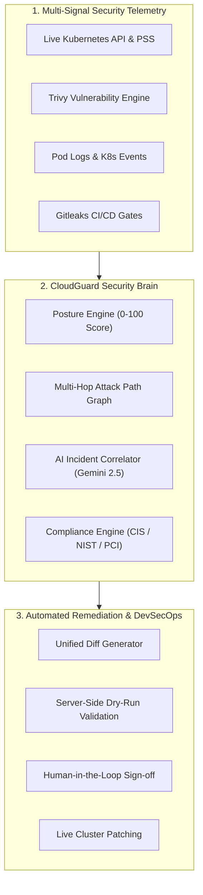

<div align="center">

# CloudGuard

### An AI-Assisted Cloud-Native DevSecOps Monitoring and Intelligent Remediation Platform

**Secure, Analyse and Optimise Your Cloud-Native Infrastructure.**

[](https://opensource.org/licenses/MIT)
[](https://github.com/cloudguard-security/cloudguard/releases)
[](https://www.python.org/)
[](https://www.typescriptlang.org/)
[](https://fastapi.tiangolo.com/)
[](https://reactjs.org/)
[](https://www.docker.com/)
[](https://kubernetes.io/)
[](#continuous-compliance-engine)
[](#ai-powered-incident-investigation)

---

</div>

## Overview

**CloudGuard** is an enterprise-grade, security-first cloud-native DevSecOps monitoring and automated remediation platform. Designed specifically for multi-tenant and production Kubernetes environments, CloudGuard continuously analyzes cluster attack surfaces, performs contextual vulnerability risk scoring, correlates cross-signal incidents using Google Gemini 2.5, verifies remediation manifests with server-side dry-runs, and enforces regulatory compliance frameworks (CIS, NIST, PCI-DSS).

---

## Core Capabilities



### 1. Intelligent Security Posture Engine
- Evaluates live cluster state against **Pod Security Standards (PSS)**, RBAC escalation paths, and missing network policies.
- Mathematical, explainable posture formula:
  $$\text{Score} = \max\left(0, 100 - (15 \times \text{Critical} + 8 \times \text{High} + 3 \times \text{Medium} + 1 \times \text{Low})\right)$$
- Color-coded letter grades (A: 90-100, B: 75-89, C: 60-74, D: 40-59, F: <40).

### 2. Advanced Vulnerability Intelligence
- Trivy-backed container image vulnerability scanner.
- Contextual risk calculation factoring runtime exposure and execution privilege:
  $$\text{Contextual Risk} = \text{CVSS} \times (1.0 + 0.3 \times \text{Exposed} + 0.4 \times \text{Privileged})$$
- Fixable-now filtering and one-click CSV export.

### 3. Kubernetes Attack Path Analysis
- Multi-hop traversal visualizer mapping complete kill-chains:
  $$\text{External Ingress / LoadBalancer} \longrightarrow \text{Vulnerable Workload Pod} \longrightarrow \text{Mounted ServiceAccount} \longrightarrow \text{Over-privileged ClusterRole} \longrightarrow \text{Target Secrets / etcd}$$
- Identifies critical choke-points to neutralize the entire attack chain with single corrective actions.

### 4. AI-Powered Incident Correlation & Investigation
- Correlates Kubernetes Warning events (`CrashLoopBackOff`, `OOMKilled`, `FailedScheduling`, `Unhealthy`) with raw pod logs.
- Gemini 2.5 deep investigation engine computes root causes, blast radius, chronological timelines, and technical recommendations.

### 5. Intelligent Remediation Center with Server-Side Dry-Run
- Generates corrective YAML manifests that eliminate root-causes while preserving workload spec.
- Verifies syntax and admission controllers server-side via `kubectl apply --dry-run=server`.
- Side-by-side unified diff viewer with mandatory human approval workflows.

### 6. Continuous Compliance Engine
- Automated compliance evaluation against:
  - **CIS Kubernetes Benchmark v1.8** (Control plane, worker node security, policies, RBAC).
  - **NIST SP 800-190** Application Container Security Guide.
  - **PCI-DSS v4.0** Requirements 6 and 7 (Container isolation and least privilege access control).

### 7. DevSecOps CI/CD Integration
- Shift-left quality gates with Gitleaks secret interception.
- Ready-to-use GitHub Actions and GitLab CI pipeline workflows.
- Webhook trigger endpoint to block non-compliant PRs before deployment.

---

## Quick Start (Docker Compose)

CloudGuard runs independently with its own database, cache, and port allocations to prevent interference with existing workloads.

### Default Ports

| Component | Container Name | Port Mapping |
| :--- | :--- | :--- |
| **Frontend Web UI** | `cloudguard-frontend` | `http://localhost:3001` |
| **Backend API Engine** | `cloudguard-backend` | `http://localhost:8001` |
| **PostgreSQL Database** | `cloudguard-postgres` | `localhost:5433` (DB: `cloudguard_db`) |
| **Redis Cache** | `cloudguard-redis` | `localhost:6380` |

### 1. Clone & Configure

```bash
cd D:\Projects\cloudguard

# Copy environment template
cp .env.example .env

# Configure your Gemini API key in .env
# GEMINI_API_KEY=your_gemini_api_key_here
```

### 2. Launch CloudGuard Services

```bash
# Build and start all 4 services in detached mode
docker compose up -d --build
```

### 3. Verify Health

```bash
# Check service status
docker compose ps

# Test Backend API Health
curl http://localhost:8001/health

# Access CloudGuard Dashboard
# Open http://localhost:3001 in your browser
```

---

## API Architecture & Routes

CloudGuard provides RESTful APIs mounted under `/api/v1/cloudguard`:

| Method | Endpoint | Description |
| :--- | :--- | :--- |
| `GET` | `/api/v1/cloudguard/posture` | Live cluster posture audit, mathematical score, and findings |
| `GET` | `/api/v1/cloudguard/vulnerabilities/scan` | Trivy container image scan with contextual risk scoring |
| `GET` | `/api/v1/cloudguard/attack-paths` | Multi-hop attack graph traversal and mitigation choke-points |
| `GET` | `/api/v1/cloudguard/incidents` | Gemini 2.5 correlated security incidents and timeline |
| `POST`| `/api/v1/cloudguard/remediation/plan` | Generate corrective YAML with server-side dry-run validation |
| `POST`| `/api/v1/cloudguard/remediation/apply` | Execute human-approved remediation manifest to live cluster |
| `GET` | `/api/v1/cloudguard/compliance` | Benchmark evaluation for CIS K8s 1.8, NIST SP 800-190, PCI-DSS |

Interactive Swagger / OpenAPI docs are available at `http://localhost:8001/docs`.

---

## Security & Isolation Guarantee

CloudGuard operates under strict isolation principles:
- **No Shared Volumes**: CloudGuard uses dedicated named volumes (`cloudguard_pgdata`, `cloudguard_redisdata`).
- **No Shared Network**: CloudGuard runs inside isolated bridge network `cloudguard-network`.
- **Dedicated Database**: Connects to `cloudguard_db` on port 5433 with user `cloudguard`.
- **Zero API Key Leakage**: Secrets and credentials are strictly loaded via server-side environment variables and never logged or serialized to frontend payloads.

---

## License

This project is licensed under the MIT License - see the [LICENSE](LICENSE) file for details.
