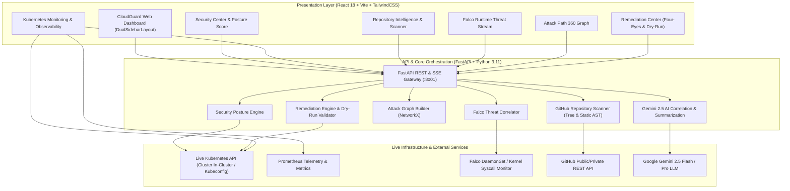
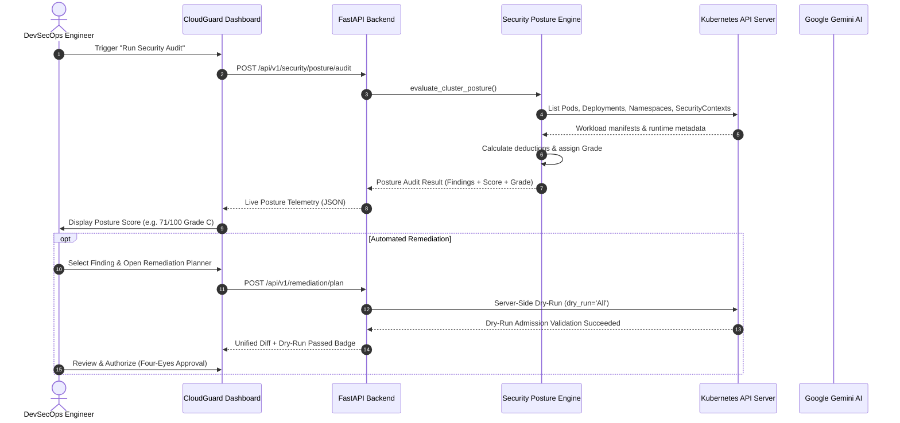

# CloudGuard Architecture & System Design

## 1. High-Level Architecture Overview

CloudGuard is an AI-assisted cloud-native DevSecOps monitoring and automated remediation platform. It provides continuous security posture assessment, Falco runtime threat intelligence, multi-hop attack path discovery, and server-side validated automated remediation for Kubernetes environments.

---

## 2. System Architecture Layers

### Presentation Layer
- **Framework:** React 18 with TypeScript and Vite.
- **Styling & UI:** TailwindCSS, Lucide React icons, Framer Motion transitions.
- **Layout Architecture:** `DualSidebarLayout` providing quick navigation between Security Center, Kubernetes Monitoring, Repository Security, Vulnerability Management, Runtime Threats, Attack Path Graph, Remediation Center, and Project Architecture.
- **Real-Time Feed:** Server-Sent Events (SSE) streaming live Kubernetes warning events and Falco runtime alerts.

### Backend API & Orchestration
- **Runtime:** Python 3.11, FastAPI, Uvicorn, Pydantic v2 schemas.
- **Data Persistence:** SQLAlchemy 2.0 with async engine and SQLite/PostgreSQL support.
- **Security Posture Engine (`security_posture_engine.py`):**
  - Evaluates live cluster workloads against Kubernetes Pod Security Standards (PSS - Baseline & Restricted) and CIS Benchmarks.
  - Formula: $\text{Score} = 100 - (3 \times \text{Critical} + 1.5 \times \text{High} + 0.5 \times \text{Medium} + 0.2 \times \text{Low})$ floored constructively.
- **Remediation Engine (`remediation_engine.py`):**
  - Manages remediation lifecycle: `pending_validation` $\to$ `dry_run_passed` $\to$ `pending_approval` $\to$ `approved` $\to$ `completed` / `rolled_back`.
  - Implements **Kubernetes Server-Side Dry-Run** (`k8s_client.patch_namespaced_deployment(..., dry_run='All')`).
  - Strict guardrails: Missing authorization token or unlisted resource mutations strictly disallow live execution.
- **Attack Path Engine (`attack_graph_engine.py`):**
  - Constructs multi-hop lateral movement graphs linking external ingress points, unhardened container runtimes, overprivileged service accounts, and sensitive Kubernetes Secrets.

---

## 3. Data Flow & Execution Sequence

---

## 4. Provenance & Data Integrity Boundaries

CloudGuard strictly separates live verified infrastructure signals from simulated/demo inputs:
1. **Live Kubernetes Telemetry:** Populated dynamically when connected to a cluster (Nodes, Pods, Deployments, CPU/Memory, SecurityContext checks).
2. **Repository Intelligence:** Dynamic GitHub tree discovery for repositories, with explicit `SIMULATED` or `DEMO DATA` indicators where deep multi-file static code analysis falls back to deterministic samples.
3. **Controlled Remediation Execution:** Even when dry-run validation and user approval pass, live execution against clusters requires explicit identity token authorization.
