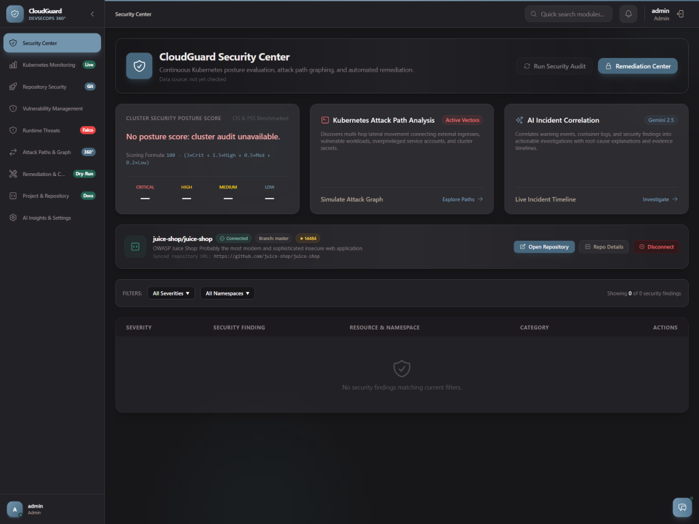
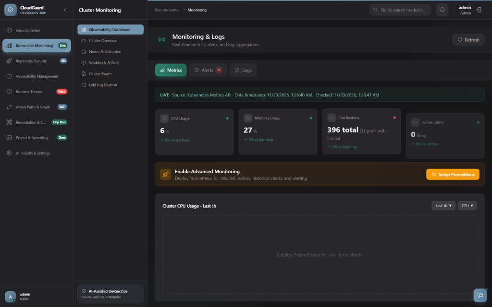
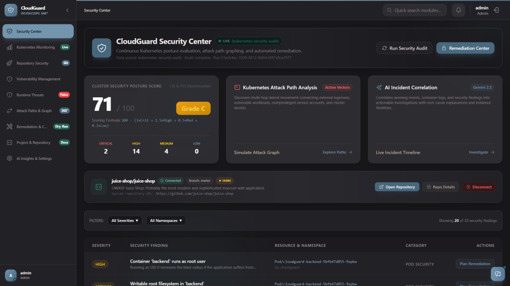
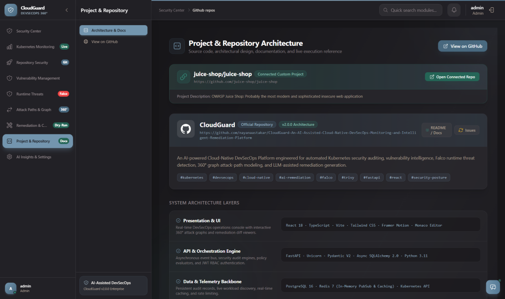
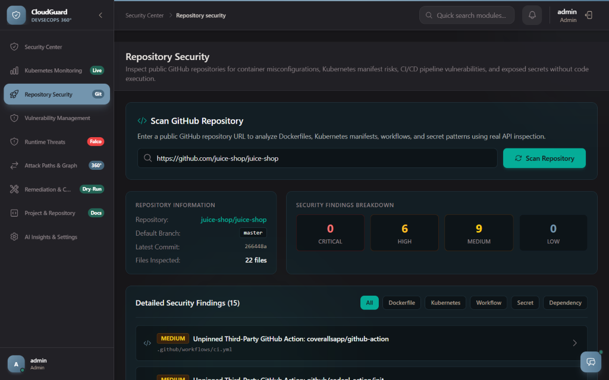
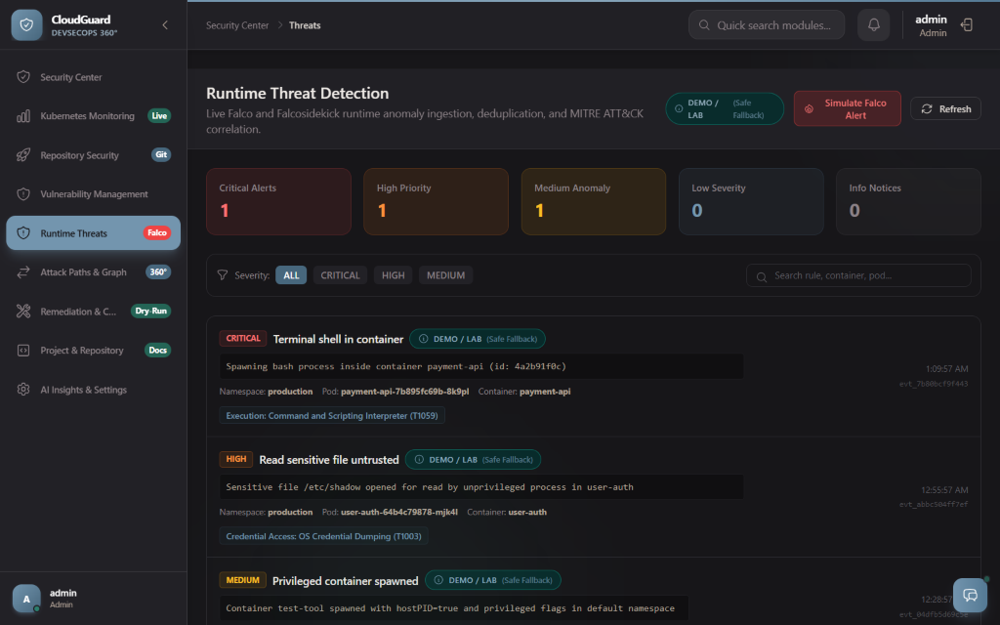
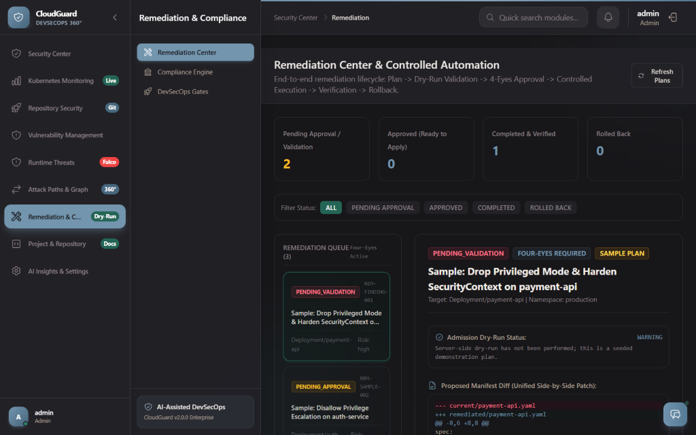
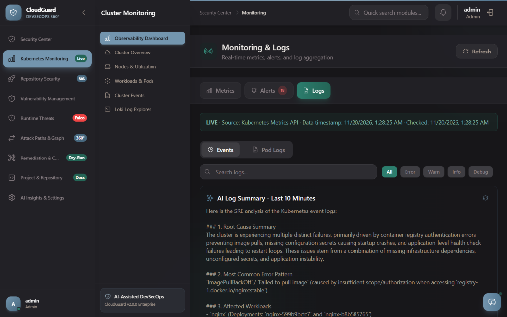
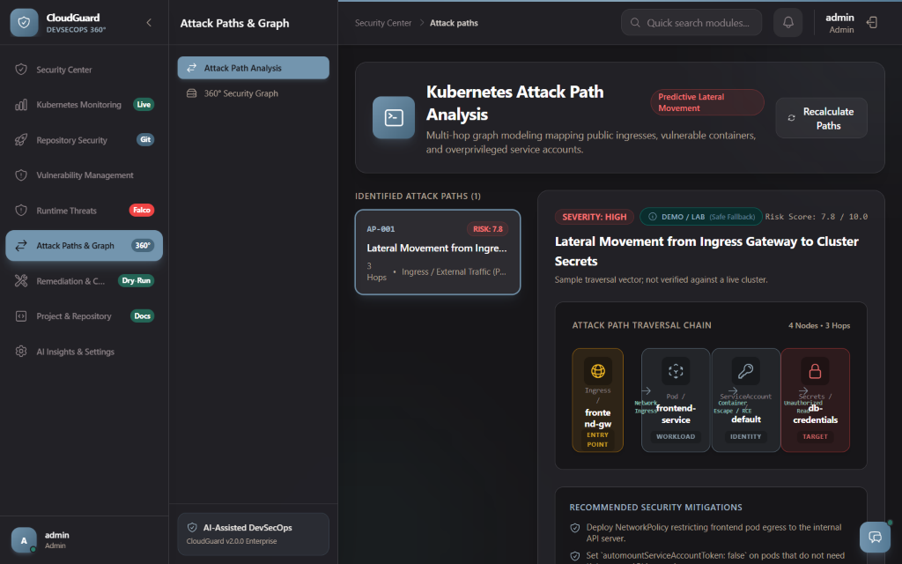
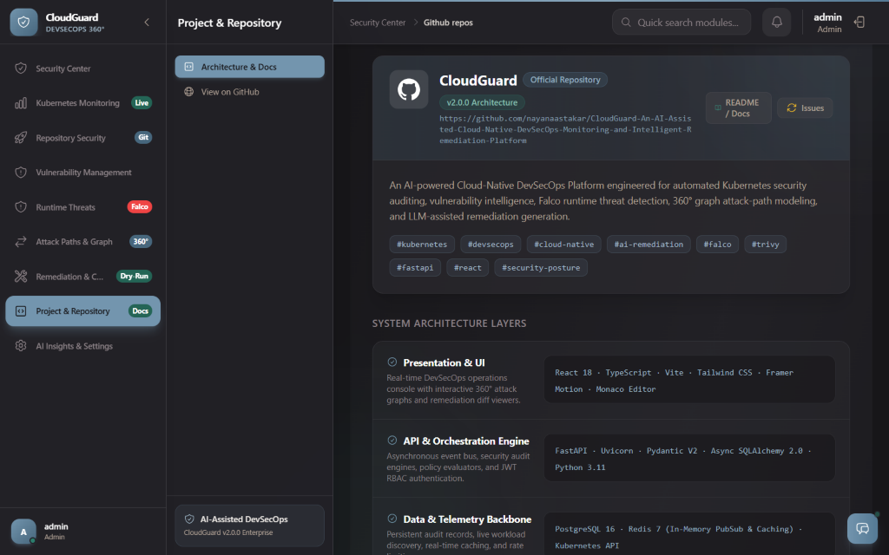

# CloudGuard Application Screenshot Gallery

This document serves as the visual reference for the CloudGuard AI-Assisted Cloud-Native DevSecOps Monitoring & Intelligent Remediation Platform. All screenshots are captured directly from the live running application at `http://localhost:3001/`.

---

## 1. Main Security Center Dashboard
Comprehensive overview of cluster security health, live benchmark deductions, attack vectors, AI correlation status, and active security findings.

- **Scoring Model:** Enterprise Pod Security Standards (PSS) & CIS benchmarked score with real-time deduction breakdowns.
- **Incident Summary:** Correlated multi-hop vectors and continuous compliance status.

---

## 2. Kubernetes Cluster Monitoring & Health
Real-time node status, pod distributions across namespaces, deployment health, and resource utilization.

- **Cluster Workloads:** Continuous inventory of Pods, Deployments, and DaemonSets.
- **Resource Metrics:** Node CPU/memory capacity tracking and container restart telemetry.

---

## 3. Security Posture Assessment & Calibrated Scoring
Detailed breakdown of security findings across cluster workloads categorized by severity (Critical, High, Medium, Low).

- **Severity Breakdown:** Instant enumeration of workload misconfigurations (e.g., container running as root, writable root filesystems, missing security context).
- **Audit Execution:** Dynamic re-evaluation via the "Run Security Audit" engine.

---

## 4. GitHub Repository Integration
Interactive repository connection interface enabling users to connect their own public or private repositories.

- **Sanitized URL Ingestion:** Automatically strips query strings, UTM trackers, and branch fragments.
- **Repository Metadata:** Dynamic retrieval of branch, stars, repository visibility, and commit activity.

---

## 5. Repository Security & Manifest Scanner
Deep static analysis and dependency scanning of connected codebase manifests.

- **Manifest Inspection:** Scans Dockerfiles, Kubernetes YAML, Helm charts, and dependency manifests.
- **Provenance Transparency:** Distinct `SIMULATED` / `DEMO DATA` indicators clearly identify offline heuristics versus live cluster audits.

---

## 6. Falco Runtime Threat Detection
Kernel-level behavioral threat monitoring stream powered by eBPF/Falco rules.

- **Real-Time Anomaly Stream:** Tracks unexpected container spawns, privilege escalations, and sensitive file access.
- **Alert Triage:** Live severity filters and correlation with active Kubernetes workloads.

---

## 7. Intelligent Remediation Center & Controlled Automation
Lifecycle management for automated security remediation with four-eyes human review.

- **Remediation Lifecycle:** Managed states (`pending_validation`, `dry_run_passed`, `pending_approval`, `approved`, `completed`).
- **Server-Side Dry-Run:** Live validation against Kubernetes API admission controllers (`dry_run='All'`) before presenting diffs.
- **Safety Lock:** Remediation application is strictly guarded by authorization checks and action allowlists.

---

## 8. Monitoring, Observability & Telemetry
Cluster metrics, aggregated container log streams, and automated AI log summarization.

- **Telemetry Streams:** Correlated warning events, container stdout/stderr, and Prometheus metrics.
- **AI Summary:** Gemini-powered 10-minute automated incident synthesis.

---

## 9. Multi-Hop Kubernetes Attack Path Analysis
Interactive 360-degree topological attack graph exposing lateral movement kill-chains.

- **Lateral Movement Traversal:** Connects unauthenticated ingress endpoints through overprivileged ServiceAccounts to target cluster secrets.
- **Choke Point Prioritization:** Highlights high-impact mitigation nodes to sever multi-stage attack vectors.

---

## 10. Project & Repository Architecture
System design reference, architectural layers, and open-source documentation.

- **Layer Reference:** Presentation UI, API & Orchestration Engine, Security Audit Workers, and Data Persistence layers.
- **Documentation:** Direct links to live API schemas and repository documentation.
